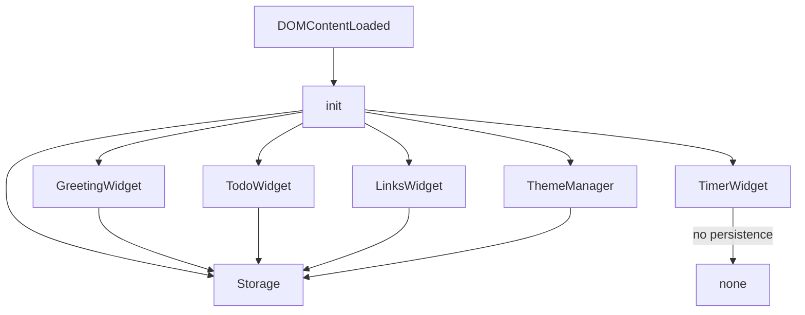
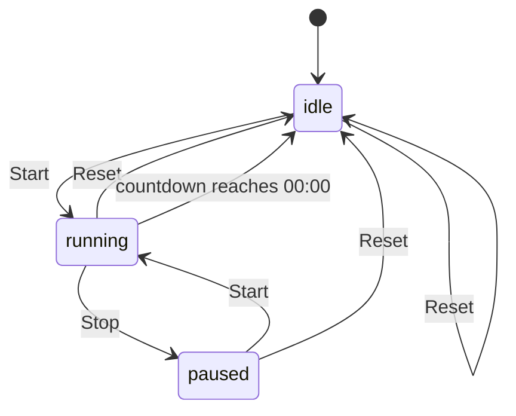

# Design Document

## Overview

The To-Do List Life Dashboard is a zero-dependency, client-side personal productivity page. It is delivered as three plain files:

- `index.html` — single HTML page, markup for all four widgets
- `css/style.css` — all visual styling, including light/dark theme variables and responsive grid
- `js/script.js` — all runtime logic: clock, todo, timer, quick links, theme toggle, and LocalStorage persistence

There is no build step, no bundler, no CDN dependency, and no backend. The page functions by opening `index.html` directly in a modern browser (Chrome, Firefox, Edge, Safari) or via GitHub Pages.

The design follows the **Feature-First Module Pattern**: each widget owns a self-contained section of JavaScript responsible for its initialization, event wiring, rendering, and storage I/O. A shared `Storage` utility and a shared `ThemeManager` sit outside widget modules and are consumed by all four widgets.

---

## Architecture

### High-Level Structure

```
index.html
├── <head> — meta, viewport, link to css/style.css
└── <body>
    ├── #theme-toggle (button)
    ├── #greeting-widget   (Clock / Greeting)
    ├── #todo-widget       (To-Do List)
    ├── #timer-widget      (Pomodoro Timer)
    ├── #links-widget      (Quick Links)
    └── <script src="js/script.js">

css/style.css
├── CSS custom properties  (--color-bg, --color-text, …)
├── [data-theme="light"]   overrides
├── [data-theme="dark"]    overrides
├── Grid layout            (.dashboard-grid)
└── Widget-specific styles

js/script.js
├── Storage module         (safe get/set/remove wrappers)
├── ThemeManager module    (toggle, persist, restore)
├── GreetingWidget module  (clock, greeting, custom name)
├── TodoWidget module      (add, toggle, delete, edit, duplicate check)
├── TimerWidget module     (countdown, state machine, mode switching)
├── LinksWidget module     (add, delete, open-in-new-tab)
└── init()                 (bootstraps all modules on DOMContentLoaded)
```

### Module Interaction Diagram



> The Timer_Widget does not persist state across page reloads: it always resets to idle / Session / 25:00 on load (Requirement 3).

---

## Components and Interfaces

### Storage Module

Provides safe JSON read/write over `localStorage`. Any parse error returns the supplied default without throwing.

```
Storage.get(key, defaultValue)  → any
Storage.set(key, value)         → void
Storage.remove(key)             → void
```

**Keys used:**

| Key | Type | Default |
|---|---|---|
| `tld_tasks` | `Task[]` | `[]` |
| `tld_links` | `QuickLink[]` | `[]` |
| `tld_theme` | `"light" \| "dark"` | `"light"` |
| `tld_name` | `string` | `""` |

> Note: There is no `tld_timer` key. The Timer_Widget does NOT persist state — it always resets to idle / Session / 25:00 on every page load.

---

### ThemeManager Module

```
ThemeManager.init()    → void   // restores theme from storage, sets data-theme on <html>
ThemeManager.toggle()  → void   // flips theme, persists
ThemeManager.get()     → "light" | "dark"
```

Theme is applied by setting `data-theme="light"` or `data-theme="dark"` on the `<html>` element; CSS custom properties handle all color changes.

---

### GreetingWidget Module

Responsibilities: live clock (setInterval every 1 s), date display, time-of-day greeting, custom name management.

```
GreetingWidget.init()             → void
GreetingWidget._tick()            → void    // updates time, date, greeting every second
GreetingWidget._getGreeting(hour) → string  // "Good Morning" | "Good Afternoon" | "Good Evening"
GreetingWidget._saveName(name)    → void
GreetingWidget._loadName()        → string
```

**Greeting rules:**
- 00:00–11:59 → "Good Morning"
- 12:00–17:59 → "Good Afternoon"
- 18:00–23:59 → "Good Evening"

---

### TodoWidget Module

Responsibilities: render task list, add/toggle/delete/edit tasks, duplicate detection, LocalStorage sync.

```
TodoWidget.init()                         → void
TodoWidget._render()                      → void     // re-renders full list from state
TodoWidget._addTask(text)                 → void
TodoWidget._deleteTask(id)                → void
TodoWidget._toggleTask(id)                → void
TodoWidget._editTask(id, newText)         → void
TodoWidget._isDuplicate(text, excludeId?) → boolean
TodoWidget._save()                        → void
TodoWidget._load()                        → Task[]
```

Each task is assigned a unique `id` using a monotonic counter seeded from `Date.now()`:

```javascript
let _nextId = Date.now();
function _genId() { return _nextId++; }
```

This prevents collisions when two tasks are created within the same millisecond.

Edit is done via `window.prompt()`:
- If the prompt is cancelled (`null`) → task left unchanged.
- If the prompt returns an empty or whitespace-only string → task left unchanged.
- If the prompt returns a duplicate of another task (case-insensitive, trimmed) → change rejected; inline warning shown.

---

### TimerWidget Module

Responsibilities: countdown state machine, mode switching (Session ↔ Break), visual alert on completion.

```
TimerWidget.init()           → void
TimerWidget._start()         → void
TimerWidget._stop()          → void   // pause
TimerWidget._reset()         → void
TimerWidget._tick()          → void   // called by setInterval
TimerWidget._onComplete()    → void   // handles 00:00 reached
TimerWidget._render()        → void   // updates display
TimerWidget._clearInterval() → void
```

**Visual Alert Element**

The Timer widget markup includes a dedicated status element:

```html
<p id="timer-status" aria-live="polite"></p>
```

Behavior:
- On Session completion → `#timer-status` displays "Session complete! Time for a break."
- On Break completion → `#timer-status` displays "Break complete! Ready for the next session?"
- `#timer-status` is cleared whenever the user activates Start or Reset.
- No audible alert is used anywhere in the widget.

**State machine:**



**Mode transitions on completion:**
- Session ends → switch to Break (5:00), enter idle
- Break ends → switch to Session (25:00), enter idle

---

### LinksWidget Module

Responsibilities: render link list, add new links, delete links, open links in new tab, LocalStorage sync.

```
LinksWidget.init()               → void
LinksWidget._render()            → void
LinksWidget._addLink(name, url)  → void
LinksWidget._deleteLink(id)      → void
LinksWidget._save()              → void
LinksWidget._load()              → QuickLink[]
```

Each QuickLink receives a unique `id` via the same monotonic `_genId()` counter used by TodoWidget, preventing collisions on rapid creation.

**Missing-Field Indication**

When the user submits the Quick_Link form:
- If the label is empty → add CSS class `.input-error` to `#link-name-input`, show `<p class="warning">Label is required.</p>`
- If the URL is empty → add CSS class `.input-error` to `#link-url-input`, show `<p class="warning">URL is required.</p>`
- If both are empty → both inputs receive `.input-error` and both warnings display
- `.input-error` and the warning text are cleared on the next `input` event on either field

---

## Data Models

### Task

```javascript
{
  id:   number,   // monotonic counter value (_genId())
  text: string,   // task description (trimmed)
  done: boolean   // completion state
}
```

Stored as `JSON.stringify(tasks)` under key `tld_tasks`.

### QuickLink

```javascript
{
  id:   number,  // monotonic counter value (_genId())
  name: string,  // display label (trimmed)
  url:  string   // full URL (trimmed)
}
```

Stored as `JSON.stringify(links)` under key `tld_links`.

### Theme

Plain string — `"light"` or `"dark"` — stored under key `tld_theme`.

### Custom Name

Plain string stored under key `tld_name`. Empty string means no name set.

---

## Behavioral Invariants (for manual verification)

*The following invariants describe expected behaviors that any correct implementation of the Dashboard must satisfy. They are verified through manual smoke testing in the browser — no automated test framework is used (per brief constraint: "No test setup required").*

### Invariant 1: Task addition round-trip

For any non-empty, non-duplicate task text, after `_addTask(text)` is called and `_save()` writes to LocalStorage, calling `_load()` MUST return an array that includes a task with the same trimmed text and `done: false`.

**Validates: Requirements 2.2, 2.8, 2.9**

---

### Invariant 2: Invalid and duplicate tasks are rejected on add

For any string composed entirely of whitespace, `_addTask(text)` SHALL NOT add the task and the task list length SHALL remain unchanged. For any text whose `trim().toLowerCase()` matches an existing task's text in the same way, `_addTask(text)` SHALL NOT add the task, the list length SHALL remain unchanged, and `_isDuplicate(text)` SHALL return `true`. The same duplicate check SHALL apply on edit: `_isDuplicate(newText, excludeId)` SHALL return `false` for the task's own current text, preventing self-collision.

**Validates: Requirements 2.3, 2.14, 2.15**

---

### Invariant 3: Task toggle is an involution

For any task in the list, toggling it twice SHALL return the task's `done` state to its original value.

**Validates: Requirements 2.5, 2.6**

---

### Invariant 4: Edit preserves completion state

For any existing task with id `i`, after `_editTask(i, newText)` with non-empty, non-duplicate `newText`, the task at id `i` SHALL have `text === newText.trim()` and its `done` state SHALL be unchanged from before the edit.

**Validates: Requirements 2.11, 2.12**

---

### Invariant 5: Greeting message covers all hours without gaps

For any integer hour `h` in [0, 23], `_getGreeting(h)` SHALL return exactly one of `"Good Morning"`, `"Good Afternoon"`, or `"Good Evening"` — never `undefined`, `null`, or any other string.

**Validates: Requirement 1.5**

---

### Invariant 6: Custom name persists through storage round-trip

For any non-empty name string `n`, after `Storage.set("tld_name", n)`, `Storage.get("tld_name", "")` SHALL return `n` unchanged.

**Validates: Requirements 1.6, 1.8**

---

### Invariant 7: Storage round-trip preserves structured data

For any array of Task objects or QuickLink objects, `Storage.set(key, value)` followed by `Storage.get(key, [])` SHALL return a value deeply equal to the original array.

**Validates: Requirements 6.1, 6.2**

---

### Invariant 8: Corrupt storage returns default without throwing

For any raw string written directly to a Dashboard key (`tld_tasks`, `tld_links`, `tld_theme`, `tld_name`), `Storage.get(key, defaultValue)` SHALL return `defaultValue` without throwing any error.

**Validates: Requirements 6.2, 6.4**

---

### Invariant 9: Quick link addition round-trip

For any non-empty label and non-empty URL, after `_addLink(name, url)` and `_save()`, calling `_load()` MUST return an array that includes a link object with matching trimmed `name` and `url`.

**Validates: Requirements 4.4, 4.7, 4.8**

---

### Invariant 10: Timer countdown format covers all valid durations

For any integer number of seconds `s` in [0, 1500] (the maximum Session duration), the time-formatting function `formatTime(s)` SHALL return a string matching the pattern `MM:SS` where both parts are zero-padded to two digits.

**Validates: Requirement 3.1**

---

### Invariant 11: Timer reset is total — always reaches idle with correct duration

For any timer state (`idle`, `running`, or `paused`) and any mode (`session` or `break`), calling `_reset()` SHALL always transition the timer to the `idle` state with `remaining` set to 1500 (Session) or 300 (Break) according to the current mode.

**Validates: Requirement 3.5**

---

### Invariant 12: Theme toggle is an involution

For any active theme value (`"light"` or `"dark"`), calling `ThemeManager.toggle()` twice SHALL restore the theme to its original value, and `Storage.get("tld_theme", "light")` SHALL equal the restored value after both toggles.

**Validates: Requirements 7.2, 7.3, 7.4**

---

## Error Handling

| Scenario | Handling |
|---|---|
| LocalStorage parse error | `Storage.get` catches `JSON.parse` exception; returns `defaultValue` |
| LocalStorage quota exceeded | `Storage.set` wraps `setItem` in try/catch; logs warning to console |
| Empty task input | `_addTask` guards on trimmed length === 0; keeps input focused |
| Duplicate task on add | `_isDuplicate` check before insert; shows inline warning `<p>` |
| Duplicate task on edit | `_isDuplicate(newText, excludeId)` check; shows inline warning |
| Edit prompt cancelled | No-op; task text and completion state unchanged |
| Edit prompt returns empty/whitespace | No-op; task unchanged |
| Edit prompt returns duplicate text | Change rejected; inline warning shown below the task |
| Empty link label or URL | `_addLink` validates both fields; highlights each missing field individually |
| Timer already running on Start | Guard: only transition if state is `idle` or `paused` |
| Timer already idle on Reset | No-op (already in idle with correct duration) |
| Timer completion | Visual message shown in `#timer-status`; no `window.alert()` |

All user-facing errors are shown as inline text elements. No `window.alert()` is used except for the Edit control which uses `window.prompt()` as specified in Requirement 2.11.

---

## Testing Strategy

Per the assignment brief ("No test setup required"), this project uses manual smoke testing only. There is no test runner, no `package.json`, no `node_modules`, and no CI.

### Manual Acceptance Testing Checklist

Each acceptance criterion in Requirements 1–8 maps to a manual browser verification step:

| # | Verification | How to test |
|---|---|---|
| R1 | Live clock updates every second | Open `index.html`, observe `#clock` for 5 s |
| R1 | Date format human-readable | Observe `#date` shows "Monday, October 12, 2026" style |
| R1 | Greeting switches by hour | Temporarily change system clock; reload |
| R1 | Custom name persists | Enter name, save, reload page |
| R2 | Add / toggle / edit / delete task | Use UI controls |
| R2 | Duplicate task rejected | Try adding the same task text twice |
| R2 | Tasks persist after reload | Add tasks, reload page |
| R3 | Timer counts down from 25:00 | Click Start, wait 3 s |
| R3 | Stop pauses, Reset returns to 25:00 | Click Stop then Reset |
| R3 | Session → Break at 00:00 | Temporarily set session to 1 min in code; wait for completion |
| R3 | Visual alert shown | Observe `#timer-status` after 00:00 |
| R4 | Add / delete Quick_Link | Use form, click Delete |
| R4 | Links open in new tab | Click a link, verify `target="_blank"` |
| R4 | Missing field shows warning | Submit form with empty label |
| R5 | Responsive layout | Resize browser below 768 px |
| R5 | No external requests | DevTools → Network tab → reload |
| R6 | Data persists | Add data, reload |
| R6 | Corrupt data recovers | Set `tld_tasks` to `"{invalid}"` in DevTools → reload |
| R7 | Theme toggle | Click toggle; verify color change |
| R7 | Theme persists | Reload; theme retained |
| R8 | Live on GitHub Pages | Open deployed URL |

---

## Project Structure and Deployment

### Repository Layout

```
CodingCamp-12October26-rhemaWiraInteosaDongalemba/
├── index.html
├── README.md
├── .kiro/                  ← generated by Kiro, committed as-is
├── css/
│   └── style.css           ← exactly 1 CSS file
└── js/
    └── script.js           ← exactly 1 JS file
```

### Constraints

- Exactly one `.css` file inside `css/`
- Exactly one `.js` file inside `js/`
- No `.scss`, `.ts`, `.jsx`, or bundled output files
- No `package.json`, no `node_modules`, no build artifacts
- `.kiro/` folder must be committed to GitHub (required for submission validity)

### Deployment Steps

1. Create GitHub repository named `CodingCamp-12October26-rhemaWiraInteosaDongalemba`
2. Commit and push all files, including `.kiro/`
3. In GitHub → Settings → Pages → Source: Deploy from branch `main` / root `/`
4. Wait for the public URL to go live (usually 1–2 minutes)
5. Verify the deployed site: all widgets work, no console errors, theme toggle works
6. Submit via Paperform: AWS Builder ID, GitHub Repo URL, GitHub Pages URL

### Definition of Done

- [ ] Live site accessible via GitHub Pages URL
- [ ] All 4 widgets work on the deployed site (Clock, To-Do, Timer, Quick Links)
- [ ] All 3 challenges work: Light/Dark theme, Custom Name, Prevent Duplicate tasks
- [ ] Light theme is default when LocalStorage is empty
- [ ] No console errors on load
- [ ] `.kiro/` folder visible in GitHub repository
